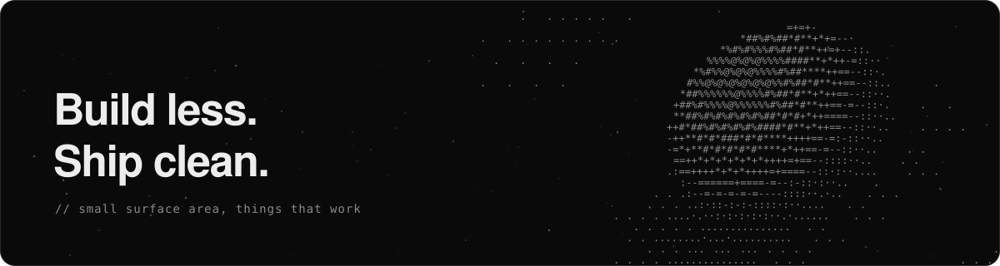
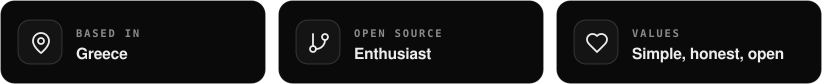
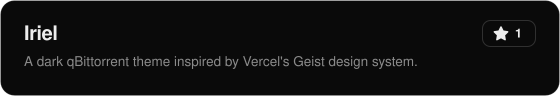

 

<h3>Hey there, I'm Iri! </h3>

  I build web apps, tools and games, mostly because I love making things that work well and feel good to use.

  Got an idea, a rough sketch, or a project that could use an extra pair of hands? I'd genuinely like to hear about it.
  No idea is too small and no question is too basic. Send me a message through the email on my profile and let's see what we can build. 

  

 

  
  
  
  
  
  

  
  
  
  
  
  
  

  
  
  
  
  

 

  

