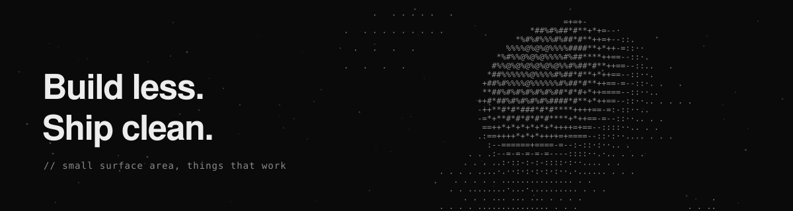

 

<table>
  <tr>
    <td width="33%" valign="top">
        
      Sites and apps with TypeScript and Astro.
    </td>
    <td width="33%" valign="top">
        
      Automation and utilities in Python.
    </td>
    <td width="33%" valign="top">
        
      Small simulations built in Godot.
    </td>
  </tr>
</table>

 

### Stack

<b>LANGUAGES</b> 

  
  
  
  
  
  

<b>FRAMEWORKS</b> 

  
  
  
  
  
  
  

<b>TOOLING</b> 

  
  
  
  
  

### Selected work

<table>
  <tr>
    <td valign="top">
      <b><a href="https://github.com/panoskoun/qBittorrent-Iriel-Dark-Theme">Iriel</a></b>
      &nbsp; 
      A dark qBittorrent theme inspired by Vercel's Geist design system.
    </td>
  </tr>
</table>

 

More projects coming as they go public.

